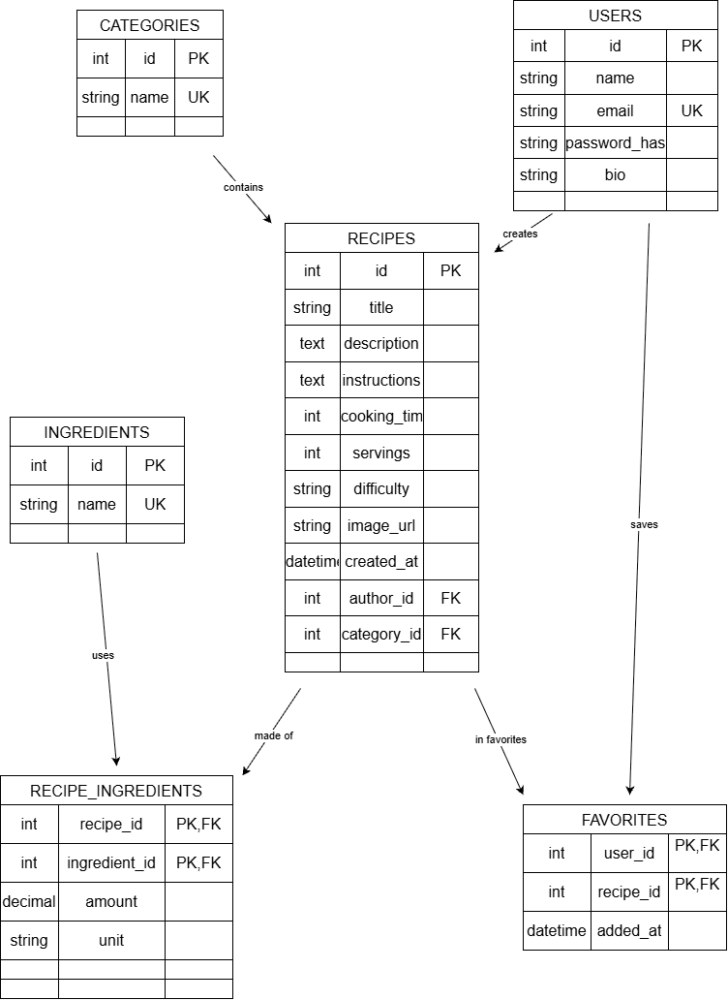

# SmachnoBook — сайт з рецептами

## Опис

**SmachnoBook** — сайт, на якому користувачі діляться рецептами, шукають, що приготувати, і зберігають улюблені страви.

**Ідея:** замість нескінченного гортання сторінок із рецептами, у кожного є одне місце, де можна швидко знайти страву за назвою, категорією, інгредієнтом чи часом приготування, а також зберегти її в «Обране» й повернутися пізніше. Рецепти додають самі користувачі, тому в кожного рецепта є автор.

**Що є на сайті:**

- Каталог рецептів із пошуком за назвою та фільтрами за категорією, інгредієнтом, складністю й часом приготування.
- Окрема сторінка рецепта: фото, опис, час приготування, складність, кількість порцій, список інгредієнтів із кількістю, покрокове приготування, автор.
- Сторінка категорій (супи, десерти, основні страви тощо) і сторінка окремої категорії з усіма її рецептами.
- Сторінка інгредієнтів і сторінка окремого інгредієнта з усіма рецептами, де його використано.
- Сторінка автора з усіма його рецептами.
- Додавання рецептів авторизованими користувачами; редагувати й видаляти рецепт може лише його автор або адміністратор.
- Керування категоріями та інгредієнтами для адміністратора.
- Реєстрація, вхід і вихід з акаунта.
- Профіль користувача: редагування власних даних, мої рецепти *(заплановано)*.
- «Обране»: авторизований користувач зберігає рецепти й бачить їх у профілі; за кількістю додавань можна сортувати рецепти за популярністю *(заплановано)*.
- Сторінка «Про нас»: контакти та правила публікації рецептів *(заплановано)*.

---

## Як запустити проєкт

1. Клонуйте репозиторій і перейдіть у його папку.
2. Створіть і активуйте віртуальне середовище:

   ```bash
   python -m venv .venv
   source .venv/bin/activate   # Windows: .venv\Scripts\activate
   ```

3. Встановіть залежності:

   ```bash
   pip install -r requirements.txt
   ```

4. Застосуйте міграції:

   ```bash
   python manage.py migrate
   ```

5. Створіть адміністратора (він зможе керувати категоріями та інгредієнтами):

   ```bash
   python manage.py createsuperuser
   ```

6. Запустіть сервер:

   ```bash
   python manage.py runserver
   ```

API доступне за адресою `http://127.0.0.1:8000/api/v1`.
Фронтенд (окремий репозиторій) очікується на `http://127.0.0.1:5500`.

---

## Postman

Колекція з усіма ендпоінтами лежить у файлі
[`postman/smachnobook.postman_collection.json`](postman/smachnobook.postman_collection.json).

1. Імпортуйте її в Postman (**Import → File**).
2. Змінна колекції `base_url` за замовчуванням дорівнює `http://127.0.0.1:8000/api/v1`.
3. У змінних `admin_username` та `admin_password` вкажіть логін і пароль адміністратора, створеного командою `createsuperuser`.
4. Запускайте запити зверху вниз. Папка **Auth** реєструє нового користувача, логінить його й адміністратора та зберігає токени у змінних `access_token`, `refresh_token` і `admin_access_token`.
5. Колекція за замовчуванням додає до кожного запиту заголовок `Authorization: Bearer {{access_token}}` (вкладка **Authorization** колекції). Запити, доступні лише адміністратору, використовують `{{admin_access_token}}`, а запити без авторизації мають тип **No Auth**.
6. Access-токен живе 5 хвилин. Якщо запит повернув `401` з повідомленням про недійсний токен, запустіть **Auth → Refresh access token**.

Ідентифікатори створених об'єктів теж зберігаються у змінних колекції автоматично. У колекції є приклади як успішних запитів, так і помилок (400, 401, 403, 404, 409).

---

## Загальні домовленості API

- Базовий URL: `/api/v1`
- Формат даних: **JSON**
- Назви ресурсів — іменники у множині, дії виражаються HTTP-методами.
- Адреси не підтримують слеш у кінці: `/recipes`, а не `/recipes/`.
- Пагінація списків: `?page=1&limit=20` (за замовчуванням `page=1`, `limit=20`, максимум `limit` — 100).
- Автором нового рецепта стає поточний користувач (за токеном), `author_id` у тілі запиту не передається.
- Повідомлення про помилки повертаються українською (`LANGUAGE_CODE = "uk"`).

### Формат помилок

Усі помилки мають єдиний формат:

```json
{ "error": "Повідомлення для користувача" }
```

Для помилок валідації додається поле `details`:

```json
{
  "error": "Некоректні дані. Перевірте поля запиту.",
  "details": { "name": ["Це поле не може бути порожнім."] }
}
```

| Ситуація                                                  | Статус |
| --------------------------------------------------------- | ------ |
| Невалідні дані, дубль назви, невірні query-параметри      | `400`  |
| Об'єкта з таким id не існує                               | `404`  |
| Видалення категорії, у якій є рецепти                     | `409`  |
| Видалення інгредієнта, який використовується в рецептах   | `409`  |
| Немає токена, токен недійсний або прострочений, невірний логін | `401`  |
| Токен валідний, але в користувача немає прав на дію       | `403`  |

`400` означає, що проблема в самому запиті. `409` означає, що запит коректний, але суперечить поточному стану даних: наприклад, не можна видалити категорію, поки в ній є рецепти.

Приклад відповіді `409`:

```json
{
  "error": "Неможливо видалити категорію «Супи», оскільки в ній рецептів: 3. Спочатку видаліть їх або перенесіть в іншу категорію."
}
```

---

## Авторизація

Для авторизації використовується **JWT** (бібліотека [`djangorestframework-simplejwt`](https://django-rest-framework-simplejwt.readthedocs.io/)). Увесь код реєстрації, логіну та прав доступу винесено в окремий Django app `users`.

### Як передавати токен

Для запитів, які вимагають авторизації, додайте заголовок:

```
Authorization: Bearer <access-токен>
```

### Токени та їх оновлення

| Токен     | Термін дії  | Для чого                                                   |
| --------- | ----------- | ---------------------------------------------------------- |
| `access`  | 5 хвилин    | Передається в заголовку `Authorization` у кожному запиті   |
| `refresh` | 1 день      | Лише для отримання нового `access` через `/auth/refresh`   |

Як це працює:

1. Після логіну (`POST /auth/login`) клієнт отримує обидва токени й зберігає їх.
2. У кожному запиті клієнт передає `access`-токен.
3. Коли `access` прострочився, сервер відповідає `401`. Клієнт надсилає `refresh` на `POST /auth/refresh`, отримує новий `access` і повторює запит. Користувачу не потрібно логінитися знову.
4. Коли прострочився і `refresh` (через 1 день), `/auth/refresh` теж повертає `401`, і користувачу потрібно увійти знову.

Токени підписані секретним ключем сервера (`SECRET_KEY`), тому сервер не зберігає їх у базі: він перевіряє підпис і термін дії. Короткий термін `access` обмежує шкоду, якщо токен вкрадуть.

### Logout

Окремого ендпоінта для виходу немає: клієнт просто видаляє збережені `access` і `refresh` токени (у фронтенді з `localStorage`). Без токенів наступні запити до захищених ендпоінтів отримають `401`.

### Ролі та права доступу

| Роль                | Хто це                                         |
| ------------------- | ---------------------------------------------- |
| Гість               | Запит без токена                               |
| Користувач          | Зареєстрований користувач з валідним токеном   |
| Адміністратор       | Користувач з `is_staff = true` (наприклад, створений через `createsuperuser`) |

| Дія                                               | Гість | Користувач          | Адміністратор |
| ------------------------------------------------- | ----- | ------------------- | ------------- |
| Переглядати рецепти, категорії, інгредієнти, авторів | так   | так                 | так           |
| Створювати рецепти                                | `401` | так                 | так           |
| Редагувати й видаляти рецепт                      | `401` | лише свій, інакше `403` | так       |
| Створювати інгредієнти                            | `401` | так                 | так           |
| Редагувати й видаляти інгредієнти                 | `401` | `403`               | так           |
| Створювати, редагувати й видаляти категорії       | `401` | `403`               | так           |
| `GET /users/me`                                   | `401` | так                 | так           |

Права описано у файлі `users/permissions.py` (класи `IsAdminOrReadOnly` та `IsAuthorOrAdminOrReadOnly`).

Приклади відповідей:

```json
{ "error": "Потрібна авторизація. Передайте access-токен у заголовку Authorization: Bearer <token>." }
```

```json
{ "error": "Токен недійсний або термін його дії минув." }
```

```json
{ "error": "Змінювати й видаляти рецепт може лише його автор або адміністратор." }
```

---

## Ендпоінти

### Авторизація (`auth`)

#### `POST /api/v1/auth/register`

Реєстрація нового користувача. Токен не потрібен.

- **Request body:**

| Поле               | Обов'язкове | Обмеження                                                  |
| ------------------ | ----------- | ---------------------------------------------------------- |
| `username`         | так         | до 150 символів, літери, цифри та `@.+-_`, унікальне       |
| `first_name`       | ні          | до 150 символів, можна залишити порожнім                   |
| `last_name`        | ні          | до 150 символів, можна залишити порожнім                   |
| `email`            | так         | до 254 символів, коректний формат, унікальний              |
| `password`         | так         | від 8 до 128 символів, не надто простий, не лише цифри, не схожий на ім'я |
| `password_confirm` | так         | має збігатися з `password`                                 |

```json
{
  "username": "olena",
  "first_name": "Олена",
  "last_name": "Коваль",
  "email": "olena@example.com",
  "password": "Strong_Pass_2026",
  "password_confirm": "Strong_Pass_2026"
}
```

- **Response:** `201 Created`. Пароль у відповіді не повертається, а в базі зберігається лише його хеш.

```json
{
  "id": 2,
  "username": "olena",
  "email": "olena@example.com",
  "first_name": "Олена",
  "last_name": "Коваль",
  "is_staff": false
}
```

- **Помилки:** `400` з повідомленням для кожного невалідного поля:

```json
{
  "error": "Некоректні дані. Перевірте поля запиту.",
  "details": {
    "email": ["Введіть коректну адресу електронної пошти."],
    "password_confirm": ["Паролі не збігаються."]
  }
}
```

#### `POST /api/v1/auth/login`

Вхід. Токен не потрібен.

- **Request body:** `{ "username": "olena", "password": "Strong_Pass_2026" }`
- **Response:** `200 OK`

```json
{
  "access": "eyJhbGciOiJIUzI1NiIsInR5cCI6IkpXVCJ9...",
  "refresh": "eyJhbGciOiJIUzI1NiIsInR5cCI6IkpXVCJ9...",
  "user": {
    "id": 2,
    "username": "olena",
    "email": "olena@example.com",
    "first_name": "Олена",
    "last_name": "Коваль",
    "is_staff": false
  }
}
```

- **Помилки:** `400` (не передано `username` або `password`), `401` (`{ "error": "Неправильне ім'я користувача або пароль." }`)

#### `POST /api/v1/auth/refresh`

Отримати новий `access`-токен. Заголовок `Authorization` не потрібен.

- **Request body:** `{ "refresh": "<refresh-токен>" }`
- **Response:** `200 OK` — `{ "access": "<новий access-токен>" }`
- **Помилки:** `400` (не передано `refresh`), `401` (`refresh` недійсний або прострочений)

#### `GET /api/v1/users/me`

Дані поточного користувача.

- **Headers:** `Authorization: Bearer <access>`
- **Response:** `200 OK` — як у відповіді реєстрації
- **Помилки:** `401`

---

### Рецепти (`recipes`)

#### `GET /api/v1/recipes`

Список рецептів із пошуком, фільтрами й сортуванням.

- **Query-параметри** (усі необов'язкові):
  - `search` — пошук за назвою
  - `category_id` — фільтр за категорією
  - `ingredient_id` — рецепти, де використано цей інгредієнт
  - `difficulty` — `easy`, `medium`, `hard`
  - `max_time` — максимальний час приготування у хвилинах
  - `sort` — `newest` (за замовчуванням), `time_asc`
  - `page`, `limit`
- **Response:** `200 OK`
- **Помилки:** `400` (невірні query-параметри)

```json
{
  "data": [
    {
      "id": 1,
      "title": "Борщ український",
      "cooking_time": 90,
      "difficulty": "medium",
      "image_url": "https://example.com/borsch.jpg",
      "category": { "id": 1, "name": "Супи" },
      "author": { "id": 3, "name": "Олена Коваль" }
    }
  ],
  "page": 1,
  "limit": 20,
  "total": 1
}
```

#### `GET /api/v1/recipes/{id}`

Повна інформація про рецепт.

- **Response:** `200 OK`
- **Помилки:** `404`

```json
{
  "id": 1,
  "title": "Борщ український",
  "description": "Класичний борщ з буряком і капустою",
  "instructions": "1. Відваріть м'ясо... 2. Додайте овочі...",
  "cooking_time": 90,
  "servings": 6,
  "difficulty": "medium",
  "image_url": "https://example.com/borsch.jpg",
  "created_at": "2025-06-01T12:00:00Z",
  "category": { "id": 1, "name": "Супи" },
  "author": { "id": 3, "name": "Олена Коваль" },
  "ingredients": [
    { "id": 5, "name": "Буряк", "amount": 2.0, "unit": "шт" },
    { "id": 8, "name": "Капуста", "amount": 300.0, "unit": "г" }
  ]
}
```

#### `POST /api/v1/recipes`

Додати новий рецепт. Автором стає поточний користувач.

- **Headers:** `Authorization: Bearer <access>`

- **Request body:**

```json
{
  "title": "Борщ український",
  "description": "Класичний борщ з буряком і капустою",
  "instructions": "1. Відваріть м'ясо... 2. Додайте овочі...",
  "cooking_time": 90,
  "servings": 6,
  "difficulty": "medium",
  "image_url": "https://example.com/borsch.jpg",
  "category_id": 1,
  "ingredients": [
    { "ingredient_id": 5, "amount": 2, "unit": "шт" },
    { "ingredient_id": 8, "amount": 300, "unit": "г" }
  ]
}
```

- **Response:** `201 Created` — створений рецепт (як у `GET /recipes/{id}`)
- **Помилки:** `400` (невалідні дані, категорії чи інгредієнта не існує, інгредієнти повторюються або список порожній), `401`

#### `PUT /api/v1/recipes/{id}`

Повністю оновити рецепт. Список інгредієнтів замінюється повністю. Доступно автору рецепта або адміністратору.

- **Headers:** `Authorization: Bearer <access>`
- **Request body:** як у `POST`
- **Response:** `200 OK` — оновлений рецепт
- **Помилки:** `400`, `401`, `403` (рецепт іншого автора), `404`

#### `DELETE /api/v1/recipes/{id}`

Видалити рецепт. Доступно автору рецепта або адміністратору.

- **Headers:** `Authorization: Bearer <access>`
- **Response:** `204 No Content`
- **Помилки:** `401`, `403` (рецепт іншого автора), `404`

---

### Категорії (`categories`)

#### `GET /api/v1/categories`

Список усіх категорій (без пагінації).

- **Response:** `200 OK`

```json
{ "data": [{ "id": 1, "name": "Супи" }] }
```

#### `GET /api/v1/categories/{id}`

Одна категорія.

- **Response:** `200 OK`
- **Помилки:** `404`

```json
{ "id": 1, "name": "Супи" }
```

#### `GET /api/v1/categories/{id}/recipes`

Усі рецепти категорії (параметри `sort`, `page`, `limit` як у списку рецептів).

- **Response:** `200 OK` — список як у `GET /recipes`
- **Помилки:** `400`, `404`

#### `POST /api/v1/categories`

Лише для адміністратора.

- **Headers:** `Authorization: Bearer <access адміністратора>`
- **Request body:** `{ "name": "Супи" }`
- **Response:** `201 Created` — створена категорія
- **Помилки:** `400` (порожня назва або категорія з такою назвою вже існує), `401`, `403`

#### `PUT /api/v1/categories/{id}`

Лише для адміністратора.

- **Headers:** `Authorization: Bearer <access адміністратора>`
- **Request body:** `{ "name": "Перші страви" }`
- **Response:** `200 OK` — оновлена категорія
- **Помилки:** `400`, `401`, `403`, `404`

#### `DELETE /api/v1/categories/{id}`

Лише для адміністратора.

- **Headers:** `Authorization: Bearer <access адміністратора>`
- **Response:** `204 No Content`
- **Помилки:** `401`, `403`, `404`, `409` (у категорії є рецепти)

---

### Інгредієнти (`ingredients`)

#### `GET /api/v1/ingredients`

Список інгредієнтів.

- **Query-параметри:** `search` — пошук за назвою, `page`, `limit`
- **Response:** `200 OK`
- **Помилки:** `400`

```json
{
  "data": [{ "id": 5, "name": "Буряк" }],
  "page": 1,
  "limit": 20,
  "total": 1
}
```

#### `GET /api/v1/ingredients/{id}`

Один інгредієнт.

- **Response:** `200 OK`
- **Помилки:** `404`

```json
{ "id": 5, "name": "Буряк" }
```

#### `GET /api/v1/ingredients/{id}/recipes`

Усі рецепти, де використано цей інгредієнт (`sort`, `page`, `limit`).

- **Response:** `200 OK` — список як у `GET /recipes`
- **Помилки:** `400`, `404`

#### `POST /api/v1/ingredients`

Доступно будь-якому авторизованому користувачу (щоб автор міг додати інгредієнт для свого рецепта).

- **Headers:** `Authorization: Bearer <access>`
- **Request body:** `{ "name": "Буряк" }`
- **Response:** `201 Created`
- **Помилки:** `400` (порожня назва або дубль), `401`

#### `PUT /api/v1/ingredients/{id}`

Лише для адміністратора.

- **Headers:** `Authorization: Bearer <access адміністратора>`
- **Request body:** `{ "name": "Буряк столовий" }`
- **Response:** `200 OK`
- **Помилки:** `400`, `401`, `403`, `404`

#### `DELETE /api/v1/ingredients/{id}`

Лише для адміністратора.

- **Headers:** `Authorization: Bearer <access адміністратора>`
- **Response:** `204 No Content`
- **Помилки:** `401`, `403`, `404`, `409` (інгредієнт використовується в рецептах)

---

### Автори (`users`)

Використовується стандартна модель користувача Django. Користувачі реєструються через `POST /auth/register`, адміністратора створюють командою `createsuperuser`.

#### `GET /api/v1/users/{id}`

Публічна інформація про автора.

- **Response:** `200 OK`
- **Помилки:** `404`

```json
{ "id": 3, "name": "Олена Коваль", "recipes_count": 12 }
```

#### `GET /api/v1/users/{id}/recipes`

Усі рецепти автора (`sort`, `page`, `limit`).

- **Response:** `200 OK` — список як у `GET /recipes`
- **Помилки:** `400`, `404`

---

## Заплановані ендпоінти (ще не реалізовано)

Ці ендпоінти буде додано в наступних роботах. Для всіх, крім «Про нас», потрібен заголовок `Authorization: Bearer <access>`.

| Ендпоінт                               | Призначення                               |
| -------------------------------------- | ----------------------------------------- |
| `PATCH /api/v1/users/me`               | Редагування власних даних (`name`, `bio`) |
| `GET /api/v1/favorites`                | Збережені рецепти поточного користувача   |
| `POST /api/v1/favorites`               | Додати рецепт в «Обране» (`recipe_id`)    |
| `DELETE /api/v1/favorites/{recipe_id}` | Прибрати рецепт з «Обраного»              |
| `GET /api/v1/about`                    | Контакти та правила публікації рецептів   |

Також після додавання «Обраного» з'являться сортування рецептів `sort=popularity` і поле `favorites_count`.

---

## Схема бази даних



**Пояснення:**

- Рецепт має одного автора (`users`) і одну категорію (зв'язок «один до багатьох»).
- Рецепти й інгредієнти пов'язані як «багато до багатьох» через таблицю `recipe_ingredients`, де додатково зберігаються кількість і одиниця виміру.
- «Обране» — теж «багато до багатьох» між користувачами та рецептами, таблиця `favorites`. Популярність рецепта рахуватиметься як кількість рядків у цій таблиці.

*Примітка: таблиця `favorites` та поле `bio` у користувача зараз у коді не реалізовані, вони з'являться разом з «Обраним» і редагуванням профілю.*

---

## Автор

Пономаренко Юрій
