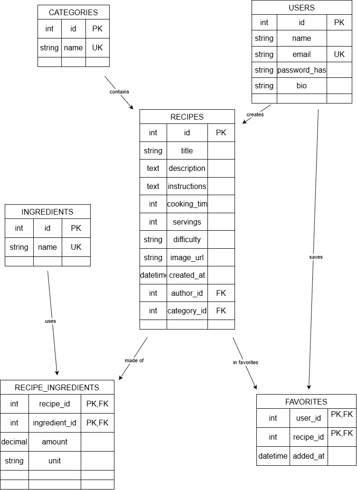

# SmachnoBook — сайт з рецептами

## Опис

**SmachnoBook** — сайт, на якому користувачі діляться рецептами, шукають, що приготувати, і зберігають улюблені страви.

**Ідея:** замість нескінченного гортання сторінок із рецептами, у кожного є одне місце, де можна швидко знайти страву за назвою, категорією, інгредієнтом чи часом приготування, а також зберегти її в «Обране» й повернутися пізніше. Рецепти додають самі користувачі, тому в кожного рецепта є автор.

**Що є на сайті:**

- Каталог рецептів із пошуком за назвою та фільтрами за категорією, інгредієнтом, складністю й часом приготування.
- Окрема сторінка рецепта: фото, опис, час приготування, складність, кількість порцій, список інгредієнтів із кількістю, покрокове приготування, автор.
- Сторінка категорій (супи, десерти, основні страви тощо) і сторінка окремої категорії з усіма її рецептами.
- Сторінка інгредієнтів і сторінка окремого інгредієнта з усіма рецептами, де його використано.
- Сторінка автора з усіма його рецептами.
- Додавання, редагування й видалення рецептів, категорій та інгредієнтів.
- Реєстрація та вхід *(заплановано)*.
- Профіль користувача: редагування власних даних, мої рецепти *(заплановано)*.
- «Обране»: авторизований користувач зберігає рецепти й бачить їх у профілі; за кількістю додавань можна сортувати рецепти за популярністю *(заплановано)*.
- Сторінка «Про нас»: контакти та правила публікації рецептів *(заплановано)*.

---

## Як запустити проєкт

1. Клонуйте репозиторій і перейдіть у його папку.
2. Створіть і активуйте віртуальне середовище:

   ```bash
   python -m venv .venv
   source .venv/bin/activate   # Windows: .venv\Scripts\activate
   ```

3. Встановіть залежності:

   ```bash
   pip install -r requirements.txt
   ```

4. Застосуйте міграції:

   ```bash
   python manage.py migrate
   ```

5. Створіть користувача (він буде автором рецептів):

   ```bash
   python manage.py createsuperuser
   ```

6. Запустіть сервер:

   ```bash
   python manage.py runserver
   ```

API доступне за адресою `http://127.0.0.1:8000/api/v1`.
Фронтенд (окремий репозиторій) очікується на `http://127.0.0.1:5500`.

---

## Postman

Колекція з усіма ендпоінтами лежить у файлі
[`postman/smachnobook.postman_collection.json`](postman/smachnobook.postman_collection.json).

1. Імпортуйте її в Postman (**Import → File**).
2. Змінна колекції `base_url` за замовчуванням дорівнює `http://127.0.0.1:8000/api/v1`.
3. У змінній `author_id` вкажіть id користувача, створеного командою `createsuperuser`.
4. Запускайте запити зверху вниз: ідентифікатори створених об'єктів зберігаються у змінних колекції автоматично. У колекції є приклади як успішних запитів, так і помилок (400, 404, 409).

---

## Загальні домовленості API

- Базовий URL: `/api/v1`
- Формат даних: **JSON**
- Назви ресурсів — іменники у множині, дії виражаються HTTP-методами.
- Адреси не підтримують слеш у кінці: `/recipes`, а не `/recipes/`.
- Пагінація списків: `?page=1&limit=20` (за замовчуванням `page=1`, `limit=20`, максимум `limit` — 100).
- Рецепти, які ще не мають авторизації: автор передається в тілі запиту як `author_id`.

### Формат помилок

Усі помилки мають єдиний формат:

```json
{ "error": "Повідомлення для користувача" }
```

Для помилок валідації додається поле `details`:

```json
{
  "error": "Некоректні дані. Перевірте поля запиту.",
  "details": { "name": ["Це поле не може бути порожнім."] }
}
```

| Ситуація                                                  | Статус |
| --------------------------------------------------------- | ------ |
| Невалідні дані, дубль назви, невірні query-параметри      | `400`  |
| Об'єкта з таким id не існує                               | `404`  |
| Видалення категорії, у якій є рецепти                     | `409`  |
| Видалення інгредієнта, який використовується в рецептах   | `409`  |

`400` означає, що проблема в самому запиті. `409` означає, що запит коректний, але суперечить поточному стану даних: наприклад, не можна видалити категорію, поки в ній є рецепти.

Приклад відповіді `409`:

```json
{
  "error": "Неможливо видалити категорію «Супи», оскільки в ній рецептів: 3. Спочатку видаліть їх або перенесіть в іншу категорію."
}
```

---

## Ендпоінти

### Рецепти (`recipes`)

#### `GET /api/v1/recipes`

Список рецептів із пошуком, фільтрами й сортуванням.

- **Query-параметри** (усі необов'язкові):
  - `search` — пошук за назвою
  - `category_id` — фільтр за категорією
  - `ingredient_id` — рецепти, де використано цей інгредієнт
  - `difficulty` — `easy`, `medium`, `hard`
  - `max_time` — максимальний час приготування у хвилинах
  - `sort` — `newest` (за замовчуванням), `time_asc`
  - `page`, `limit`
- **Response:** `200 OK`
- **Помилки:** `400` (невірні query-параметри)

```json
{
  "data": [
    {
      "id": 1,
      "title": "Борщ український",
      "cooking_time": 90,
      "difficulty": "medium",
      "image_url": "https://example.com/borsch.jpg",
      "category": { "id": 1, "name": "Супи" },
      "author": { "id": 3, "name": "Олена Коваль" }
    }
  ],
  "page": 1,
  "limit": 20,
  "total": 1
}
```

#### `GET /api/v1/recipes/{id}`

Повна інформація про рецепт.

- **Response:** `200 OK`
- **Помилки:** `404`

```json
{
  "id": 1,
  "title": "Борщ український",
  "description": "Класичний борщ з буряком і капустою",
  "instructions": "1. Відваріть м'ясо... 2. Додайте овочі...",
  "cooking_time": 90,
  "servings": 6,
  "difficulty": "medium",
  "image_url": "https://example.com/borsch.jpg",
  "created_at": "2025-06-01T12:00:00Z",
  "category": { "id": 1, "name": "Супи" },
  "author": { "id": 3, "name": "Олена Коваль" },
  "ingredients": [
    { "id": 5, "name": "Буряк", "amount": 2.0, "unit": "шт" },
    { "id": 8, "name": "Капуста", "amount": 300.0, "unit": "г" }
  ]
}
```

#### `POST /api/v1/recipes`

Додати новий рецепт.

- **Request body:**

```json
{
  "title": "Борщ український",
  "description": "Класичний борщ з буряком і капустою",
  "instructions": "1. Відваріть м'ясо... 2. Додайте овочі...",
  "cooking_time": 90,
  "servings": 6,
  "difficulty": "medium",
  "image_url": "https://example.com/borsch.jpg",
  "category_id": 1,
  "author_id": 3,
  "ingredients": [
    { "ingredient_id": 5, "amount": 2, "unit": "шт" },
    { "ingredient_id": 8, "amount": 300, "unit": "г" }
  ]
}
```

- **Response:** `201 Created` — створений рецепт (як у `GET /recipes/{id}`)
- **Помилки:** `400` (невалідні дані, категорії, автора чи інгредієнта не існує, інгредієнти повторюються або список порожній)

*TODO: після додавання авторизації `author_id` буде прибрано, а автором стане поточний користувач.*

#### `PUT /api/v1/recipes/{id}`

Повністю оновити рецепт. Список інгредієнтів замінюється повністю.

- **Request body:** як у `POST`
- **Response:** `200 OK` — оновлений рецепт
- **Помилки:** `400`, `404`

*TODO: після авторизації редагувати рецепт зможе лише його автор (`401`, `403`).*

#### `DELETE /api/v1/recipes/{id}`

Видалити рецепт.

- **Response:** `204 No Content`
- **Помилки:** `404`

---

### Категорії (`categories`)

#### `GET /api/v1/categories`

Список усіх категорій (без пагінації).

- **Response:** `200 OK`

```json
{ "data": [{ "id": 1, "name": "Супи" }] }
```

#### `GET /api/v1/categories/{id}`

Одна категорія.

- **Response:** `200 OK`
- **Помилки:** `404`

```json
{ "id": 1, "name": "Супи" }
```

#### `GET /api/v1/categories/{id}/recipes`

Усі рецепти категорії (параметри `sort`, `page`, `limit` як у списку рецептів).

- **Response:** `200 OK` — список як у `GET /recipes`
- **Помилки:** `400`, `404`

#### `POST /api/v1/categories`

- **Request body:** `{ "name": "Супи" }`
- **Response:** `201 Created` — створена категорія
- **Помилки:** `400` (порожня назва або категорія з такою назвою вже існує)

#### `PUT /api/v1/categories/{id}`

- **Request body:** `{ "name": "Перші страви" }`
- **Response:** `200 OK` — оновлена категорія
- **Помилки:** `400`, `404`

#### `DELETE /api/v1/categories/{id}`

- **Response:** `204 No Content`
- **Помилки:** `404`, `409` (у категорії є рецепти)

---

### Інгредієнти (`ingredients`)

#### `GET /api/v1/ingredients`

Список інгредієнтів.

- **Query-параметри:** `search` — пошук за назвою, `page`, `limit`
- **Response:** `200 OK`
- **Помилки:** `400`

```json
{
  "data": [{ "id": 5, "name": "Буряк" }],
  "page": 1,
  "limit": 20,
  "total": 1
}
```

#### `GET /api/v1/ingredients/{id}`

Один інгредієнт.

- **Response:** `200 OK`
- **Помилки:** `404`

```json
{ "id": 5, "name": "Буряк" }
```

#### `GET /api/v1/ingredients/{id}/recipes`

Усі рецепти, де використано цей інгредієнт (`sort`, `page`, `limit`).

- **Response:** `200 OK` — список як у `GET /recipes`
- **Помилки:** `400`, `404`

#### `POST /api/v1/ingredients`

- **Request body:** `{ "name": "Буряк" }`
- **Response:** `201 Created`
- **Помилки:** `400` (порожня назва або дубль)

#### `PUT /api/v1/ingredients/{id}`

- **Request body:** `{ "name": "Буряк столовий" }`
- **Response:** `200 OK`
- **Помилки:** `400`, `404`

#### `DELETE /api/v1/ingredients/{id}`

- **Response:** `204 No Content`
- **Помилки:** `404`, `409` (інгредієнт використовується в рецептах)

---

### Автори (`users`)

Поки що використовується стандартна модель користувача Django. Користувачів створює адміністратор командою `createsuperuser` або через `/admin`.

#### `GET /api/v1/users/{id}`

Публічна інформація про автора.

- **Response:** `200 OK`
- **Помилки:** `404`

```json
{ "id": 3, "name": "Олена Коваль", "recipes_count": 12 }
```

#### `GET /api/v1/users/{id}/recipes`

Усі рецепти автора (`sort`, `page`, `limit`).

- **Response:** `200 OK` — список як у `GET /recipes`
- **Помилки:** `400`, `404`

---

## Заплановані ендпоінти (ще не реалізовано)

Ці ендпоінти буде додано в наступних роботах. Для всіх, крім реєстрації, входу та «Про нас», потрібен заголовок `Authorization: Bearer <token>`. *TODO: уточнити механізм токенів на етапі авторизації.*

| Ендпоінт                          | Призначення                                |
| --------------------------------- | ------------------------------------------ |
| `POST /api/v1/auth/register`      | Реєстрація (`name`, `email`, `password`)   |
| `POST /api/v1/auth/login`         | Вхід, повертає токен                       |
| `GET /api/v1/users/me`         | Дані поточного користувача                 |
| `PATCH /api/v1/users/me`       | Редагування власних даних (`name`, `bio`)  |
| `GET /api/v1/favorites`        | Збережені рецепти поточного користувача    |
| `POST /api/v1/favorites`       | Додати рецепт в «Обране» (`recipe_id`)     |
| `DELETE /api/v1/favorites/{recipe_id}` | Прибрати рецепт з «Обраного»              |
| `GET /api/v1/about`               | Контакти та правила публікації рецептів    |

Також після додавання «Обраного» з'являться сортування рецептів `sort=popularity` і поле `favorites_count`.

---

## Схема бази даних



**Пояснення:**

- Рецепт має одного автора (`users`) і одну категорію (зв'язок «один до багатьох»).
- Рецепти й інгредієнти пов'язані як «багато до багатьох» через таблицю `recipe_ingredients`, де додатково зберігаються кількість і одиниця виміру.
- «Обране» — теж «багато до багатьох» між користувачами та рецептами, таблиця `favorites`. Популярність рецепта рахуватиметься як кількість рядків у цій таблиці.

*Примітка: таблиця `favorites` та поле `bio` у користувача зараз у коді не реалізовані, вони з'являться разом з авторизацією й «Обраним».*

---

## Автор

Пономаренко Юрій
